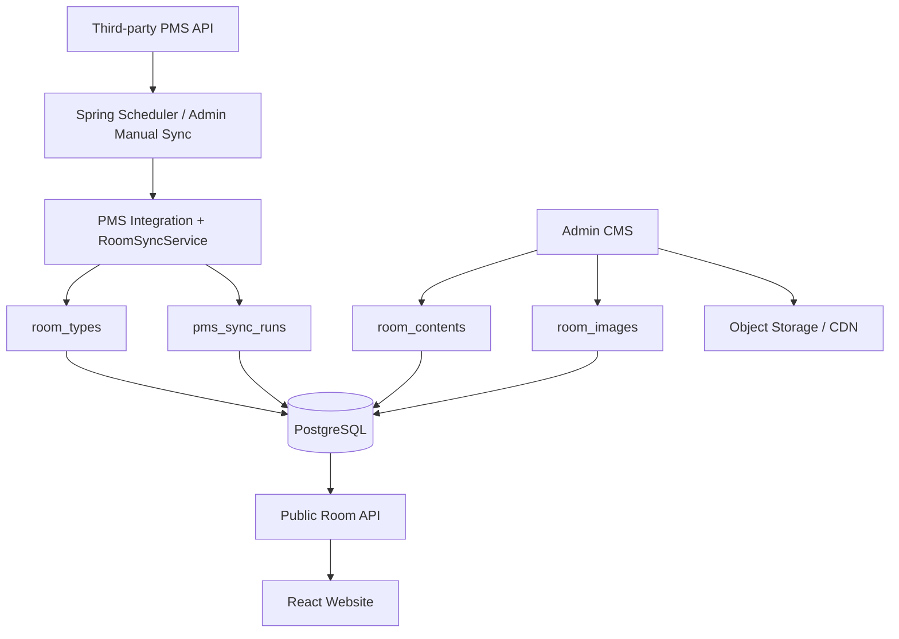
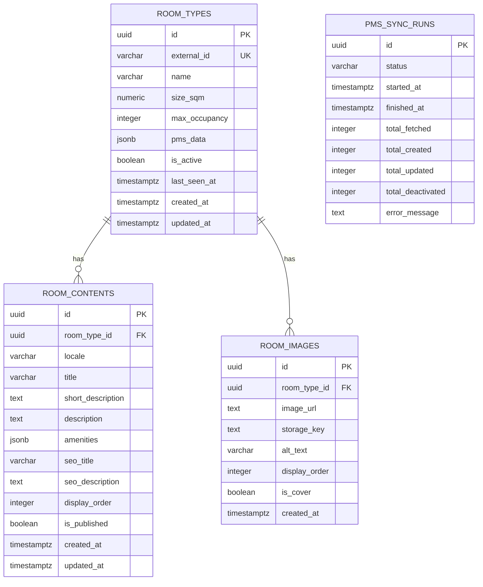
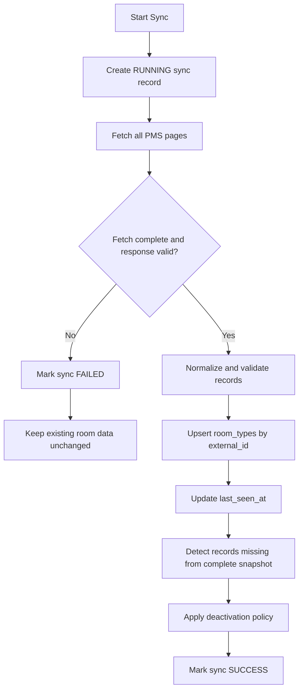

# Technical Design Document

## PMS Integration + Local Room Catalog + Room Content CMS

**Phiên bản:** 1.0\
**Ngày:** 11/11/2026\
**Phạm vi:** Website resort -- React Frontend, Java Spring Boot Backend,
PostgreSQL\
**Trạng thái:** Đề xuất kiến trúc; cần đối chiếu với tài liệu API PMS
trước khi triển khai.

------------------------------------------------------------------------

## 1. Mục tiêu và bối cảnh

Website có menu **Phòng / Rooms**. Danh sách loại phòng hiện được lấy từ
API của PMS/Booking Engine bên thứ ba. API hiện cung cấp một số thông
tin cơ bản như tên phòng, diện tích, sức chứa..., nhưng không cung cấp
đầy đủ nội dung marketing như hình ảnh, mô tả chi tiết và tiện ích.

Admin cần có khả năng: - Xem danh sách loại phòng được lấy từ PMS. - Bổ
sung và chỉnh sửa nội dung hiển thị trên website. - Upload, sắp xếp và
chọn ảnh đại diện. - Quản lý tiện ích, SEO metadata và ngôn ngữ. -
Publish/Unpublish nội dung.

### 1.1. Thông tin dự án đã xác nhận

  Hạng mục                       Thông tin
  ------------------------------ ---------------------------------
  PMS API                        Có API lấy danh sách loại phòng
  Tần suất thay đổi room types   Hiếm khi thay đổi
  Quy mô                         Một resort / một property
  Webhook từ PMS                 Chưa xác định
  Frontend                       React
  Backend                        Java Spring Boot
  Database                       PostgreSQL

### 1.2. Vấn đề cần giải quyết

Không nên để website phụ thuộc vào PMS mỗi lần khách truy cập trang
Rooms. Nếu PMS chậm, lỗi hoặc giới hạn request, trang phòng cũng bị ảnh
hưởng. Ngoài ra, phải ghép dữ liệu từ PMS với dữ liệu CMS ở thời điểm
runtime nếu sử dụng hai API độc lập.

### 1.3. Mục tiêu thiết kế

1.  PMS là nguồn dữ liệu chuẩn cho các thuộc tính nghiệp vụ do PMS quản
    lý.
2.  Database website là nguồn dữ liệu chuẩn cho nội dung marketing do
    Admin quản lý.
3.  Đồng bộ dữ liệu PMS về local database theo lịch và theo yêu cầu
    Admin.
4.  Public API chỉ đọc local database; không gọi PMS trong request hiển
    thị trang phòng.
5.  Không để quá trình đồng bộ làm mất nội dung CMS.
6.  Có thể mở rộng đa ngôn ngữ, nhiều ảnh và nhiều property về sau mà
    không cần thiết kế lại toàn bộ.

------------------------------------------------------------------------

## 2. Quyết định kiến trúc

### 2.1. Kiến trúc được chọn

**PMS Integration + Local Room Catalog + Room Content CMS**

PMS cung cấp dữ liệu loại phòng cơ bản. Backend định kỳ đồng bộ dữ liệu
đó vào bảng `room_types`. Admin quản lý nội dung bổ sung trong
`room_contents` và `room_images`. Public API kết hợp dữ liệu từ các bảng
local và trả về một response hoàn chỉnh cho React.



### 2.2. Phân tách trách nhiệm dữ liệu

  -----------------------------------------------------------------------
  Nhóm dữ liệu            Ví dụ                   Nguồn dữ liệu chuẩn
  ----------------------- ----------------------- -----------------------
  Thuộc tính PMS          External room ID, tên,  PMS
                          diện tích, sức chứa     

  Nội dung marketing      Tiêu đề, mô tả ngắn, mô Website CMS
                          tả chi tiết             

  Hình ảnh                Cover, gallery, alt     Object Storage +
                          text, thứ tự ảnh        Website DB metadata

  Trạng thái xuất bản     Draft, Published        Website CMS

  Availability / giá theo Giá, số phòng còn, điều PMS / Booking Engine
  ngày                    kiện booking            tại thời điểm tra cứu
  -----------------------------------------------------------------------

Không được dùng dữ liệu catalog đã đồng bộ để khẳng định giá hoặc tình
trạng phòng còn trống tại thời điểm đặt phòng.

### 2.3. Những phương án không chọn

**Gọi hai API mỗi lần khách mở trang** - Ưu điểm: dữ liệu PMS luôn được
hỏi trực tiếp. - Nhược điểm: phụ thuộc latency/uptime/rate limit của
PMS; phải join hai nguồn dữ liệu trong mỗi request; khó đảm bảo trải
nghiệm ổn định. - Kết luận: không chọn cho Room Listing/Room Detail.

**Nhập thủ công toàn bộ loại phòng vào CMS** - Ưu điểm: đơn giản, không
phụ thuộc PMS khi hiển thị. - Nhược điểm: trùng lặp dữ liệu, Admin phải
nhập lại thông tin PMS và dễ lệch dữ liệu. - Kết luận: không chọn.

------------------------------------------------------------------------

## 3. Phạm vi và giả định

### 3.1. Trong phạm vi

-   Đồng bộ danh sách room types từ PMS.
-   Lưu bản sao local của các field cần dùng.
-   Quản lý nội dung theo room type và locale.
-   Quản lý gallery ảnh.
-   Publish/Unpublish.
-   Public list/detail API.
-   Lịch sử đồng bộ và xử lý lỗi.
-   Scheduled Sync và Manual Sync.

### 3.2. Ngoài phạm vi

-   Quản lý inventory/availability.
-   Tính giá phòng hoặc khuyến mãi.
-   Tạo/sửa/hủy booking.
-   Thay thế PMS hoặc Booking Engine.
-   Xây dựng CMS tổng quát cho toàn bộ website.
-   Đồng bộ real-time bằng webhook ở giai đoạn đầu.

### 3.3. Giả định cần xác minh với nhà cung cấp PMS

Trước khi code cần xác nhận: 1. ID loại phòng có ổn định và duy nhất
trong property không? 2. API có pagination không? Làm thế nào xác định
đã lấy hết dữ liệu? 3. API trả danh sách loại phòng đang hoạt động hay
cả loại đã ngừng kinh doanh? 4. Có field status hoặc deleted indicator
không? 5. API có rate limit, timeout và authentication expiry như thế
nào? 6. Có webhook/event khi room type thay đổi không? 7. Có
sandbox/test environment không? 8. Các field name, size unit và
occupancy semantics chính xác là gì?

Nếu ID PMS không ổn định, phải có quy trình mapping thủ công hoặc một
external mapping key khác. Không được tự động coi một ID mới là cùng một
phòng chỉ vì tên giống nhau.

------------------------------------------------------------------------

## 4. Database Design

Đề xuất 4 bảng: - `room_types`: dữ liệu catalog được đồng bộ từ PMS. -
`room_contents`: nội dung CMS theo locale. - `room_images`: metadata
ảnh. - `pms_sync_runs`: lịch sử mỗi lần đồng bộ.

### 4.1. ERD



### 4.2. DDL tham khảo

DDL dưới đây là baseline. Cần điều chỉnh tên field, độ dài, kiểu dữ liệu
và nullability theo response thực tế của PMS và convention của
repository.

``` sql
CREATE EXTENSION IF NOT EXISTS pgcrypto;

CREATE TABLE room_types (
    id UUID PRIMARY KEY DEFAULT gen_random_uuid(),
    external_id VARCHAR(100) NOT NULL UNIQUE,
    name VARCHAR(255) NOT NULL,
    size_sqm NUMERIC(8, 2),
    max_occupancy INTEGER,
    pms_data JSONB NOT NULL DEFAULT '{}'::jsonb,
    is_active BOOLEAN NOT NULL DEFAULT TRUE,
    last_seen_at TIMESTAMPTZ,
    created_at TIMESTAMPTZ NOT NULL DEFAULT NOW(),
    updated_at TIMESTAMPTZ NOT NULL DEFAULT NOW(),
    CONSTRAINT chk_room_types_size_nonnegative
        CHECK (size_sqm IS NULL OR size_sqm >= 0),
    CONSTRAINT chk_room_types_occupancy_positive
        CHECK (max_occupancy IS NULL OR max_occupancy > 0)
);

CREATE INDEX idx_room_types_active
    ON room_types (is_active);

CREATE TABLE room_contents (
    id UUID PRIMARY KEY DEFAULT gen_random_uuid(),
    room_type_id UUID NOT NULL REFERENCES room_types(id),
    locale VARCHAR(10) NOT NULL,
    title VARCHAR(255),
    short_description TEXT,
    description TEXT,
    amenities JSONB NOT NULL DEFAULT '[]'::jsonb,
    seo_title VARCHAR(255),
    seo_description TEXT,
    display_order INTEGER NOT NULL DEFAULT 0,
    is_published BOOLEAN NOT NULL DEFAULT FALSE,
    created_at TIMESTAMPTZ NOT NULL DEFAULT NOW(),
    updated_at TIMESTAMPTZ NOT NULL DEFAULT NOW(),
    CONSTRAINT uq_room_contents_room_locale
        UNIQUE (room_type_id, locale)
);

CREATE INDEX idx_room_contents_public
    ON room_contents (locale, is_published, display_order);

CREATE TABLE room_images (
    id UUID PRIMARY KEY DEFAULT gen_random_uuid(),
    room_type_id UUID NOT NULL REFERENCES room_types(id),
    image_url TEXT NOT NULL,
    storage_key TEXT NOT NULL,
    alt_text VARCHAR(255),
    display_order INTEGER NOT NULL DEFAULT 0,
    is_cover BOOLEAN NOT NULL DEFAULT FALSE,
    created_at TIMESTAMPTZ NOT NULL DEFAULT NOW()
);

CREATE INDEX idx_room_images_room_order
    ON room_images (room_type_id, display_order);

CREATE UNIQUE INDEX uq_room_images_one_cover_per_room
    ON room_images (room_type_id)
    WHERE is_cover = TRUE;

CREATE TABLE pms_sync_runs (
    id UUID PRIMARY KEY DEFAULT gen_random_uuid(),
    status VARCHAR(20) NOT NULL,
    started_at TIMESTAMPTZ NOT NULL DEFAULT NOW(),
    finished_at TIMESTAMPTZ,
    total_fetched INTEGER NOT NULL DEFAULT 0,
    total_created INTEGER NOT NULL DEFAULT 0,
    total_updated INTEGER NOT NULL DEFAULT 0,
    total_deactivated INTEGER NOT NULL DEFAULT 0,
    error_message TEXT,
    CONSTRAINT chk_pms_sync_runs_status
        CHECK (status IN ('RUNNING', 'SUCCESS', 'FAILED'))
);

CREATE INDEX idx_pms_sync_runs_started_at
    ON pms_sync_runs (started_at DESC);
```

### 4.3. Ghi chú thiết kế schema

**`room_types.external_id`** - Là khóa định danh từ PMS. - Không dùng
`name` làm khóa. - Unique constraint hiện phù hợp với giả định một PMS
và một property. - Nếu sau này có nhiều provider/property, đổi sang
unique `(provider_code, property_external_id, external_id)`.

**`room_types.pms_data`** - Giữ response gốc hoặc subset cần
audit/debug. - Không nên phụ thuộc hoàn toàn vào JSONB cho các field cần
filter/sort thường xuyên. - Chỉ cập nhật các cột do PMS sở hữu; không
cập nhật field CMS.

**`room_contents.locale`** - Một room type có thể có một bản ghi nội
dung cho mỗi ngôn ngữ. - Ví dụ `vi`, `en`, `ja`. - Nếu website chỉ có
một ngôn ngữ, có thể bắt đầu với một locale mặc định nhưng vẫn nên giữ
mô hình locale nếu đã có kế hoạch đa ngôn ngữ.

**`room_contents.amenities`** - JSONB array là lựa chọn đơn giản cho
danh sách tiện ích chỉ dùng để hiển thị. - Nếu cần quản lý danh mục tiện
ích tập trung, dịch riêng từng tiện ích hoặc filter/search theo tiện
ích, cân nhắc bảng `amenities` và bảng liên kết.

**`room_images`** - Lưu metadata, không lưu binary. - `storage_key` dùng
để xóa/thay thế file ở Object Storage. - `image_url` có thể là public
CDN URL hoặc URL được sinh từ storage key. - Partial unique index bảo
đảm tối đa một cover cho mỗi room type. Việc đổi cover cần thực hiện
trong transaction.

**Xóa dữ liệu** - Không cascade delete nội dung CMS khi PMS ngừng trả về
room type. - Dùng `room_types.is_active = false`. - Chỉ xóa vật lý theo
quy trình quản trị riêng sau khi xác nhận không còn tham chiếu.

------------------------------------------------------------------------

## 5. PMS Integration Design

### 5.1. Thành phần Backend

``` text
room/
├── controller/
│   ├── PublicRoomController.java
│   └── AdminRoomController.java
├── service/
│   ├── RoomQueryService.java
│   ├── RoomContentService.java
│   └── RoomSyncService.java
├── repository/
│   ├── RoomTypeRepository.java
│   ├── RoomContentRepository.java
│   ├── RoomImageRepository.java
│   └── PmsSyncRunRepository.java
├── integration/
│   └── pms/
│       ├── PmsClient.java
│       ├── PmsRoomResponse.java
│       └── PmsRoomMapper.java
├── scheduler/
│   └── RoomSyncScheduler.java
├── dto/
├── entity/
└── mapper/
```

### 5.2. Trách nhiệm

  -----------------------------------------------------------------------
  Component                           Trách nhiệm
  ----------------------------------- -----------------------------------
  `PmsClient`                         Authentication, gọi PMS endpoint,
                                      timeout và deserialize response

  `PmsRoomResponse`                   DTO phản ánh response thực tế của
                                      PMS

  `PmsRoomMapper`                     Map PMS DTO sang command/model nội
                                      bộ

  `RoomSyncService`                   Orchestrate fetch, validate,
                                      upsert, detect missing rooms và ghi
                                      sync result

  `RoomContentService`                CRUD CMS content và publish state

  `RoomQueryService`                  Đọc dữ liệu local cho public API

  `RoomSyncScheduler`                 Kích hoạt sync tự động

  `PmsSyncRunRepository`              Ghi lịch sử sync
  -----------------------------------------------------------------------

Không để `RoomQueryService` gọi trực tiếp PMS.

### 5.3. Scheduled Sync

Vì danh sách loại phòng hiếm khi thay đổi, lịch đồng bộ một lần mỗi ngày
là đủ cho giai đoạn đầu. Ví dụ chạy lúc 02:00 theo giờ Việt Nam.

``` java
@Component
@RequiredArgsConstructor
public class RoomSyncScheduler {

    private final RoomSyncService roomSyncService;

    @Scheduled(
        cron = "0 0 2 * * *",
        zone = "Asia/Ho_Chi_Minh"
    )
    public void syncRooms() {
        roomSyncService.sync();
    }
}
```

Bật scheduling:

``` java
@Configuration
@EnableScheduling
public class SchedulingConfig {
}
```

Lưu ý: - Cần bật scheduling đúng theo cấu hình ứng dụng. - Nếu chạy
nhiều Backend instance, dùng distributed lock (ví dụ ShedLock) hoặc cơ
chế khóa tương đương để tránh chạy trùng. - Nên cấu hình timeout, retry
có giới hạn và logging. - Không retry vô hạn với lỗi authentication hoặc
response không hợp lệ.

### 5.4. Manual Sync

Admin có thể chủ động yêu cầu đồng bộ qua endpoint:

`POST /api/v1/admin/room-types/sync`

Quy tắc: - Chỉ Admin có quyền phù hợp được gọi. - Có thể trả
`202 Accepted` nếu sync chạy bất đồng bộ; hoặc `200 OK` nếu xử lý đồng
bộ và thời gian ngắn. - Chống chạy đồng thời nhiều sync. - Trả về sync
run ID để Admin xem trạng thái. - Không để request sync từ Admin làm lộ
PMS credentials.

Với số lượng room type nhỏ, có thể bắt đầu bằng xử lý đồng bộ nếu API
PMS phản hồi nhanh và số trang ít. Nếu không, chuyển sang background
task.

------------------------------------------------------------------------

## 6. Chi tiết thuật toán đồng bộ

### 6.1. Quy trình tổng quát



### 6.2. Quy tắc Upsert

Dựa trên `external_id`:

  -----------------------------------------------------------------------
  Trạng thái                          Hành động
  ----------------------------------- -----------------------------------
  Chưa có external ID                 INSERT room type mới

  Đã có external ID                   UPDATE các field do PMS sở hữu

  Có trong DB nhưng không có trong    Đưa vào quy trình xác
  snapshot hoàn chỉnh                 minh/deactivate

  PMS đổi tên                         UPDATE name, giữ nguyên CMS content

  PMS đổi diện tích/sức chứa          UPDATE field tương ứng, giữ nguyên
                                      CMS content
  -----------------------------------------------------------------------

Pseudo-code:

``` java
for (PmsRoom room : pmsRooms) {
    RoomType entity = repository.findByExternalId(room.externalId())
        .orElseGet(() -> RoomType.newFromPms(room));

    entity.updatePmsOwnedFields(room);
    entity.setLastSeenAt(syncStartedAt);

    repository.save(entity);
}
```

Đây là minh họa logic, không phải implementation cuối cùng. Có thể dùng
bulk upsert nếu cần tối ưu.

### 6.3. Xử lý phòng không còn xuất hiện trong PMS

Không được suy luận rằng một room type đã bị xóa chỉ vì một response
rỗng, response thiếu trang hoặc API lỗi.

Chỉ thực hiện detect missing khi: 1. Tất cả các trang đã fetch thành
công. 2. Response schema hợp lệ. 3. API có ngữ nghĩa rõ ràng là trả về
toàn bộ danh sách cần đồng bộ. 4. Không có lỗi giữa chừng.

Với dữ liệu hiếm thay đổi, khuyến nghị an toàn: - Lần đầu không thấy
room trong snapshot đầy đủ: ghi nhận missing/last_seen_at và chưa xóa
CMS. - Lần sync thành công tiếp theo vẫn không thấy: đánh dấu
`is_active = false`. - Nếu PMS có status/deleted flag đáng tin cậy, ưu
tiên dùng flag đó theo tài liệu nhà cung cấp.

Nếu cần theo dõi số lần vắng mặt chính xác, có thể bổ sung
`missing_since` hoặc `consecutive_missing_count` vào `room_types`.

### 6.4. Transaction và tính toàn vẹn

Không nên cập nhật từng room vào database trong khi vẫn đang fetch các
trang PMS. Hãy: 1. Fetch hết dữ liệu vào bộ nhớ/staging. 2. Validate
toàn bộ snapshot. 3. Chỉ sau khi snapshot hợp lệ mới bắt đầu transaction
cập nhật local DB. 4. Upsert các room type và cập nhật trạng thái
missing trong transaction. 5. Ghi sync result thành công.

Với lượng dữ liệu nhỏ, có thể thực hiện trong một transaction. Với dữ
liệu lớn, cân nhắc staging table và transaction theo batch nhưng phải
bảo đảm không deactivate dựa trên snapshot chưa hoàn chỉnh.

`pms_sync_runs` cần phản ánh `RUNNING`, `SUCCESS`, `FAILED`. Nếu
transaction cập nhật catalog rollback, vẫn cần ghi được trạng thái
FAILED ở một transaction riêng hoặc sau khi rollback.

### 6.5. Xử lý lỗi

  -----------------------------------------------------------------------
  Lỗi                                 Hành vi
  ----------------------------------- -----------------------------------
  PMS timeout                         Sync FAILED, giữ nguyên catalog

  HTTP 5xx                            Retry có giới hạn; nếu vẫn lỗi thì
                                      FAILED

  HTTP 401/403                        FAILED, cảnh báo cấu hình
                                      credentials

  Response không đúng schema          FAILED, không cập nhật catalog

  Pagination thiếu trang              FAILED, không detect missing

  Response rỗng bất thường            Không deactivate; đánh dấu cần kiểm
                                      tra

  Database lỗi                        Rollback cập nhật catalog, ghi lỗi
                                      sync

  Một record thiếu field optional     Xử lý theo mapping/nullability đã
                                      thống nhất

  External ID trùng trong cùng        Reject snapshot hoặc xử lý theo quy
  snapshot                            tắc được xác nhận; không upsert mơ
                                      hồ
  -----------------------------------------------------------------------

### 6.6. ID PMS thay đổi

Đây là rủi ro quan trọng cần xác minh trước khi triển khai.

-   Nếu ID ổn định: dùng `external_id` làm natural key mapping.
-   Nếu PMS có ID thay đổi: không tự động tạo room mới rồi để Admin nhập
    lại content.
-   Cần một bảng alias/mapping hoặc quy trình Admin liên kết external ID
    mới với room type local cũ.
-   Không tự động match chỉ dựa vào tên, vì tên có thể trùng hoặc thay
    đổi.

------------------------------------------------------------------------

## 7. Admin CMS Workflow

### 7.1. Room Management List

Admin nhìn thấy tất cả room type đã sync, bao gồm cả loại phòng chưa có
nội dung.

Thông tin nên hiển thị: - Tên room type từ PMS. - External ID. - Diện
tích/sức chứa (nếu PMS cung cấp). - Trạng thái PMS active/inactive. -
Trạng thái CMS: Missing / Draft / Published. - Lần sync gần nhất. -
Action Edit.

Không chỉ hiển thị các room đã publish, vì Admin cần phát hiện room mới
chưa được nhập nội dung.

### 7.2. Edit Room Content

Admin có thể: - Nhập title. - Nhập short description và description. -
Quản lý amenities. - Chọn locale. - Nhập SEO title/description. - Sắp
xếp thứ tự hiển thị. - Lưu Draft. - Publish/Unpublish.

### 7.3. Image Management

Admin UI tách **hai mục upload** (không tách bảng):

1.  **Ảnh chính (cover)** — một ảnh đại diện cho list `/rooms`. Nếu đã
    có cover thì khóa upload; phải xóa cover hiện tại rồi mới upload
    ảnh khác (`asCover=true` trả lỗi khi cover đã tồn tại).
2.  **Gallery** — nhiều ảnh (multi-select) cho trang detail. Upload
    `asCover=false`, không tự chuyển thành cover.

Model dữ liệu vẫn là một bảng `room_images` với cờ `is_cover` (tối đa
một cover / room type). Cover và gallery dùng chung pipeline upload;
phân biệt bằng query `asCover=true|false` và endpoint đặt cover.

Quy trình: 1. Admin chọn file ở mục Cover hoặc Gallery. 2. Backend xác
thực quyền, MIME type, dung lượng và phần mở rộng. 3. Upload file lên
Object Storage / local disk. 4. Nhận storage key và URL/CDN URL. 5. Lưu
metadata vào `room_images` (`is_cover` theo mục upload). 6. Trả metadata
cho Admin.

Cần xử lý trường hợp upload thành công nhưng lưu DB thất bại: xóa object
vừa upload hoặc đưa vào cơ chế cleanup. Khi xóa ảnh, xóa metadata và
object theo quy trình an toàn; tránh xóa object trước khi transaction DB
chắc chắn thành công.

Khuyến nghị: - Chỉ chấp nhận các định dạng ảnh cần thiết như JPEG, PNG,
WebP. - Giới hạn kích thước file. - Sinh tên object key ngẫu nhiên,
không dùng nguyên tên file do người dùng cung cấp. - Không tin tưởng
MIME type do client gửi; xác minh nội dung file. - Dùng CDN và tối ưu
kích thước/thumbnail. - Không cho phép upload HTML/SVG tùy ý nếu chưa có
cơ chế sanitize an toàn.

### 7.4. Publish Rules

Một room content chỉ được publish nếu đáp ứng các điều kiện nghiệp vụ đã
thống nhất, ví dụ: - Room type đang active. - Có title. - Có description
hoặc short description theo yêu cầu thiết kế. - Có ít nhất một ảnh nếu
website yêu cầu ảnh bắt buộc. - Locale hợp lệ.

Nên kiểm tra điều kiện publish ở Backend, không chỉ ẩn/disable nút trên
Frontend.

Room chưa publish hoặc room type inactive sẽ không xuất hiện trong
Public Room API.

------------------------------------------------------------------------

## 8. API Design

Tên endpoint là đề xuất; cần thống nhất với convention API hiện có.

### 8.1. Admin APIs

  -------------------------------------------------------------------------------------------------------------
  Method                  Endpoint                                                      Mục đích
  ----------------------- ------------------------------------------------------------- -----------------------
  GET                     `/api/v1/admin/room-types`                                    Danh sách room types đã
                                                                                        sync và trạng thái CMS

  GET                     `/api/v1/admin/room-types/{id}`                               Chi tiết room type và
                                                                                        nội dung CMS

  POST                    `/api/v1/admin/room-types/sync`                               Kích hoạt manual sync

  GET                     `/api/v1/admin/room-sync-runs`                                Danh sách lịch sử sync

  GET                     `/api/v1/admin/room-sync-runs/{runId}`                        Chi tiết một sync run

  PUT                     `/api/v1/admin/room-types/{id}/contents/{locale}`             Tạo/cập nhật content

  POST                    `/api/v1/admin/room-types/{id}/images?asCover=true\|false`    Upload cover hoặc gallery

  PUT                     `/api/v1/admin/room-types/{id}/images/reorder`                Sắp xếp gallery

  PUT                     `/api/v1/admin/room-types/{id}/images/{imageId}/cover`        Chọn cover

  DELETE                  `/api/v1/admin/room-types/{id}/images/{imageId}`              Xóa ảnh

  POST                    `/api/v1/admin/room-types/{id}/contents/{locale}/publish`     Publish

  POST                    `/api/v1/admin/room-types/{id}/contents/{locale}/unpublish`   Unpublish
  -------------------------------------------------------------------------------------------------------------

### 8.2. Public APIs

  -------------------------------------------------------------------------------------
  Method                  Endpoint                              Mục đích
  ----------------------- ------------------------------------- -----------------------
  GET                     `/api/v1/room-types?locale=en`        Danh sách phòng đã
                                                                publish

  GET                     `/api/v1/room-types/{id}?locale=en`   Chi tiết một loại phòng
                                                                đã publish
  -------------------------------------------------------------------------------------

Public API chỉ đọc local database. Không gọi PMS trong request này.

### 8.3. Ví dụ Public List Response

``` json
{
  "data": [
    {
      "id": "local-room-uuid",
      "externalId": "PMS-ROOM-001",
      "name": "Ocean View Deluxe",
      "sizeSqm": 45,
      "maxOccupancy": 2,
      "content": {
        "locale": "en",
        "title": "Ocean View Deluxe",
        "shortDescription": "Enjoy a beautiful ocean view.",
        "description": "A spacious room with beautiful ocean views.",
        "amenities": [
          "King Bed",
          "Private Balcony",
          "Ocean View"
        ],
        "seoTitle": "Ocean View Deluxe | Resort",
        "seoDescription": "Discover our Ocean View Deluxe room."
      },
      "images": [
        {
          "url": "https://cdn.example.com/room-1.webp",
          "altText": "Ocean View Deluxe room",
          "isCover": true,
          "displayOrder": 1
        }
      ]
    }
  ]
}
```

Không bắt buộc public response phải expose `externalId`; chỉ expose nếu
Frontend thực sự cần. Không expose raw PMS payload.

### 8.4. Query logic

Pseudo SQL:

``` sql
SELECT
    rt.id,
    rt.external_id,
    rt.name,
    rt.size_sqm,
    rt.max_occupancy,
    rc.locale,
    rc.title,
    rc.short_description,
    rc.description,
    rc.amenities,
    rc.seo_title,
    rc.seo_description
FROM room_types rt
JOIN room_contents rc
    ON rc.room_type_id = rt.id
WHERE rt.is_active = TRUE
  AND rc.is_published = TRUE
  AND rc.locale = :locale
ORDER BY rc.display_order ASC, rt.name ASC;
```

Images có thể query riêng theo danh sách room IDs hoặc fetch bằng một
query JOIN/aggregation phù hợp. Tránh N+1 query khi lấy list.

### 8.5. Locale fallback

Cần quyết định chính sách fallback. Đề xuất: - Nếu locale yêu cầu có nội
dung Published: trả locale đó. - Nếu không có: fallback sang locale mặc
định, ví dụ `vi`, nếu sản phẩm yêu cầu. - Nếu cả hai đều không có: không
trả room đó. - Response phải ghi rõ locale thực tế được trả về để
Frontend không hiểu nhầm.

------------------------------------------------------------------------

## 9. Cache và hiệu năng

Với một resort và số lượng room types nhỏ: - PostgreSQL và query JOIN là
đủ ở giai đoạn đầu. - Chưa cần Redis chỉ cho Room Catalog. - Có thể dùng
HTTP cache/ETag hoặc application cache nếu có nhu cầu. - Khi Admin cập
nhật/publish/unpublish content, phải invalidate cache liên quan. - Khi
sync cập nhật room types, cũng invalidate cache Room Catalog. - Không
cache availability/giá theo ngày như cache content tĩnh.

------------------------------------------------------------------------

## 10. Bảo mật và vận hành

### 10.1. PMS Credentials

-   Lưu trong environment variables hoặc secret manager.
-   Không commit credentials vào source code.
-   Không trả credentials hoặc raw error chứa secret về client.
-   Dùng HTTPS.
-   Cấu hình timeout và connection pool phù hợp.

### 10.2. Admin Authorization

-   Tất cả Admin endpoints phải yêu cầu authentication và
    role/permission phù hợp.
-   Manual Sync cần permission riêng nếu cần.
-   Upload/delete image phải được kiểm tra quyền.
-   Ghi audit log cho các thao tác publish, unpublish, thay đổi nội dung
    và xóa ảnh nếu hệ thống có yêu cầu.

### 10.3. Logging/Monitoring

Nên log: - Sync run ID. - Thời điểm bắt đầu/kết thúc. - Tổng số record
fetch/create/update/deactivate. - PMS HTTP status và thời gian phản
hồi. - Lỗi theo từng giai đoạn.

Không log access token, password hoặc dữ liệu nhạy cảm.

### 10.4. Backup

-   Backup PostgreSQL.
-   Object Storage cần bật versioning hoặc có chính sách backup phù hợp.
-   Khi xóa room content hoặc ảnh, cần có chính sách khôi phục nếu phù
    hợp với yêu cầu vận hành.

------------------------------------------------------------------------

## 11. Booking và Availability

Room Catalog không phải nguồn dữ liệu cho booking.

Luồng đề xuất: 1. Khách mở Room Listing: lấy catalog từ local Public
Room API. 2. Khách mở Room Detail: tiếp tục lấy thông tin mô tả và ảnh
từ local DB. 3. Khách chọn ngày check-in/check-out và số khách: Backend
gọi PMS/Booking Engine để lấy giá và availability theo ngày. 4. Khi
khách tiếp tục booking: thực hiện quy trình xác nhận/đặt phòng của
PMS/Booking Engine. 5. Không khẳng định booking thành công chỉ dựa trên
dữ liệu catalog hoặc availability cache cũ.

------------------------------------------------------------------------

## 12. Test Strategy

### 12.1. PMS Client Tests

-   HTTP success với response hợp lệ.
-   Authentication failure.
-   Timeout.
-   HTTP 5xx.
-   Response schema không hợp lệ.
-   Pagination nhiều trang.
-   Response trùng external ID.

### 12.2. Sync Service Tests

-   Room mới được insert.
-   Room hiện có được update.
-   Tên/size thay đổi nhưng CMS content và images không đổi.
-   Snapshot đầy đủ không còn room: áp dụng chính sách missing.
-   Fetch lỗi giữa pagination: catalog không thay đổi.
-   Response rỗng bất thường: không deactivate.
-   Duplicate sync request được chặn.
-   Sync history ghi SUCCESS/FAILED đúng.
-   Database transaction rollback khi lỗi.

### 12.3. CMS Tests

-   Admin tạo/cập nhật content theo locale.
-   Unique room type + locale.
-   Draft không xuất hiện ở public API.
-   Publish validation.
-   Unpublish làm room biến mất khỏi public API.
-   Upload ảnh hợp lệ.
-   Từ chối file không hợp lệ/quá dung lượng.
-   Chọn cover đảm bảo tối đa một cover.
-   Reorder gallery.

### 12.4. Public API Tests

-   Chỉ trả room active và published.
-   Locale filtering/fallback đúng.
-   Room chưa có content không xuất hiện.
-   Không có N+1 query nghiêm trọng.
-   Response không expose raw PMS payload hoặc thông tin nội bộ.

------------------------------------------------------------------------

## 13. Implementation Roadmap

### Phase 0 -- PMS Contract Verification

-   Thu thập Swagger/OpenAPI hoặc response mẫu.
-   Xác nhận external ID ổn định.
-   Xác nhận pagination và semantics của danh sách.
-   Xác nhận field mapping, unit và nullable fields.
-   Kiểm tra rate limit, auth, timeout và webhook.
-   Chốt mapping table và DDL cuối cùng.

**Điều kiện hoàn tất:** Có tài liệu API PMS và mapping rõ ràng.

### Phase 1 -- Database & PMS Integration

-   Tạo migrations.
-   Implement PMS Client và DTO.
-   Implement mapping.
-   Implement full snapshot fetch và validation.
-   Implement upsert.
-   Implement missing-room policy.
-   Implement sync history.
-   Implement scheduled/manual sync.
-   Viết unit/integration tests.

**Điều kiện hoàn tất:** Có thể đồng bộ an toàn và lỗi PMS không làm hỏng
catalog hiện tại.

### Phase 2 -- Room Content CMS

-   Admin room list.
-   Content editor theo locale.
-   Image upload/gallery.
-   Display order.
-   Draft/Publish/Unpublish.
-   Authorization và validation.

**Điều kiện hoàn tất:** Admin quản lý được nội dung của các room types
đã sync.

### Phase 3 -- Public APIs

-   Room list.
-   Room detail.
-   Locale handling.
-   Image ordering/cover.
-   Query tối ưu, tránh N+1.
-   Public API tests.

**Điều kiện hoàn tất:** Frontend chỉ cần gọi local API để hiển thị trang
phòng.

### Phase 4 -- React Integration

-   Room listing page.
-   Room detail page.
-   Gallery.
-   Responsive UI.
-   Loading/empty/error states.
-   SEO metadata.

### Phase 5 -- Production Hardening

-   Monitoring/logging.
-   Backup.
-   Rate limiting cho Admin operations nếu cần.
-   Object Storage cleanup.
-   Cache invalidation nếu đã bật cache.
-   Kiểm tra bảo mật và phân quyền.
-   Kiểm thử end-to-end.

------------------------------------------------------------------------

## 14. Business Rules cần thống nhất

  -----------------------------------------------------------------------
  ID                                  Rule
  ----------------------------------- -----------------------------------
  BR-01                               PMS là nguồn chuẩn cho các field
                                      room type được PMS quản lý.

  BR-02                               Website CMS là nguồn chuẩn cho
                                      title, description, amenities,
                                      images và SEO content.

  BR-03                               Room type được mapping bằng
                                      external ID ổn định, không bằng
                                      tên.

  BR-04                               Sync không được ghi đè nội dung
                                      CMS.

  BR-05                               Public API chỉ trả room type active
                                      và content Published theo locale.

  BR-06                               Room mới từ PMS mặc định chưa
                                      Published.

  BR-07                               PMS API lỗi hoặc snapshot không
                                      hoàn chỉnh thì không được
                                      deactivate room.

  BR-08                               PMS không còn trả room trong
                                      snapshot hoàn chỉnh thì áp dụng
                                      missing-room policy; không xóa vật
                                      lý CMS.

  BR-09                               Giá và availability phải được kiểm
                                      tra qua PMS/Booking Engine theo
                                      ngày đặt.

  BR-10                               Chỉ Admin có quyền mới được sửa
                                      content, upload ảnh, publish hoặc
                                      manual sync.

  BR-11                               Không được có hơn một cover image
                                      cho một room type.

  BR-12                               Việc đổi external ID cần
                                      mapping/reconciliation có kiểm
                                      soát.
  -----------------------------------------------------------------------

------------------------------------------------------------------------

## 15. Các câu hỏi còn mở

Các mục dưới đây phải được xác minh trước hoặc trong Phase 0:

  Câu hỏi                                     Tác động
  ------------------------------------------- -------------------------------------
  PMS external ID có ổn định không?           Quyết định khóa mapping
  API có pagination không?                    Quyết định cách lấy snapshot đầy đủ
  API có trả status/deleted flag không?       Quyết định deactivate policy
  Webhook có hỗ trợ không?                    Có thể bổ sung event-triggered sync
  Có giới hạn request không?                  Điều chỉnh scheduler/retry
  Có nhiều locale cho CMS không?              Chốt locale/fallback
  Ảnh lưu ở S3 hay Cloudinary?                Chốt upload/storage adapter
  Có cần admin preview trước publish không?   Ảnh hưởng CMS workflow

Webhook hiện chưa phải điều kiện bắt buộc. Với room types hiếm thay đổi,
daily sync và manual sync là đủ cho phiên bản đầu tiên.

------------------------------------------------------------------------

## 16. Tiêu chí nghiệm thu

Có thể coi module hoàn thành khi:

1.  Hệ thống lấy được toàn bộ room types từ PMS.
2.  Sync lần đầu tạo local room catalog chính xác.
3.  Sync lần sau cập nhật các field PMS mà không làm mất CMS content.
4.  API PMS lỗi không làm thay đổi catalog hiện tại.
5.  Room mới xuất hiện trong Admin ở trạng thái chưa có nội dung/Draft.
6.  Admin có thể nhập nội dung, upload và sắp xếp ảnh.
7.  Admin có thể publish/unpublish theo locale.
8.  Public API chỉ trả các phòng active và Published.
9.  React hiển thị Room List/Detail mà không cần gọi PMS trực tiếp.
10. Giá và availability vẫn được truy vấn từ PMS/Booking Engine trong
    luồng booking.
11. Có lịch sử sync để kiểm tra thành công/thất bại.
12. Có test cho các trường hợp sync lỗi, room mới, room bị thiếu và CMS
    content preservation.

------------------------------------------------------------------------

## 17. Hướng dẫn sử dụng tài liệu với Cursor

Khi đưa tài liệu này vào repository, đề xuất đặt tại:

`docs/technical-design/room-catalog-cms.md`

Prompt tham khảo cho Cursor:

> Read `docs/technical-design/room-catalog-cms.md` and inspect the
> existing repository before making changes.
>
> First, report the current architecture, conventions, database
> migration tool, API response conventions, authentication/authorization
> approach, file storage implementation, and existing PMS integration
> (if any).
>
> Compare the repository with the TDD. Identify conflicts, missing
> information, and implementation dependencies. Do not assume PMS field
> names or API behavior that are not present in the repository or
> official PMS documentation.
>
> Propose an implementation plan broken down by phases. Do not implement
> everything at once. Start with Phase 0 verification and Phase 1 only
> after the PMS API contract and mapping have been confirmed.
>
> Preserve existing project conventions. Do not introduce Redis, Kafka,
> RabbitMQ, or additional infrastructure unless a demonstrated
> requirement justifies it.
>
> Pay special attention to these invariants: - PMS sync must never
> overwrite CMS-owned content. - An incomplete or failed PMS snapshot
> must never deactivate room types. - Public Room APIs must not call
> PMS. - Booking price and availability must still be checked through
> the PMS/Booking Engine. - Do not use room name as the identity key
> when a stable external ID is available.
>
> Before implementing, provide the proposed migration, API contract,
> sync algorithm, and tests for review.

------------------------------------------------------------------------

## 18. Kết luận

Kiến trúc phù hợp với dự án hiện tại là **PMS Integration + Local Room
Catalog + Room Content CMS**.

Không cần xây dựng một hệ thống đồng bộ phức tạp hoặc triển khai message
broker ở giai đoạn đầu. Một Spring Scheduler chạy hằng ngày, kết hợp
Manual Sync trong Admin, là giải pháp vừa đủ.

Điểm quan trọng nhất không nằm ở tần suất sync mà nằm ở tính an toàn của
đồng bộ: - External ID phải được xác minh. - Phải fetch và validate đầy
đủ trước khi cập nhật. - Phải phân biệt dữ liệu PMS và dữ liệu CMS. -
Không xóa nội dung CMS khi PMS thay đổi hoặc ngừng trả một room type. -
Không dùng catalog cache thay cho dữ liệu booking real-time.

**Tài liệu này là thiết kế nền tảng. DDL, field mapping và API contract
cuối cùng cần được xác nhận bằng tài liệu/response thực tế của PMS trước
khi triển khai production.**
